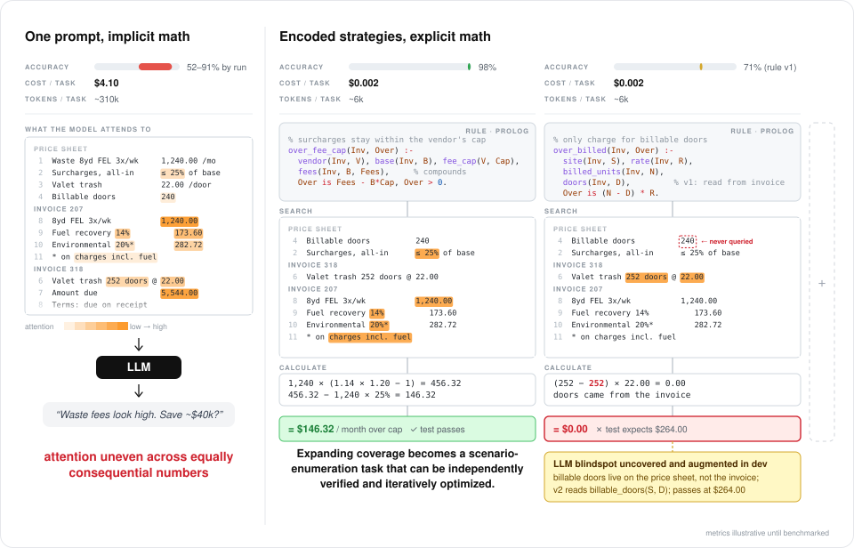

# MARC-inference

Most agentic solutions for property management aim to automate the administrative burden. MARC goes further: it infers implicit contractual terms from invoices, GL exports and pricing sheets, and uses them to drive agent-led negotiation that brings down OpEx for goods and services.

The search strategy for savings opportunities has the most direct impact on that value proposition, yet it's also the greatest source of uncertainty in the system and the part most likely to change. This repo proposes a hypothetical, scalable pipeline built around that tension, with stated trade-offs and mitigation strategies.

On a real-world dataset, the [benchmark](#benchmark) tests a toy implementation of the search pipeline the system is built around, matching a state-of-the-art model's precision at a fraction of the cost.

## The problem

Most negotiated rates aren't written down anywhere MARC can read. Documents provide noisy observations of the rate a property really pays, and the engine has to work back from those observations to implicit agreements, then find where a property pays more than it should:

```
                      hidden agreement
          (vendor, rate, escalator, which properties)
                             │
        ┌────────────────────┼─────────────────────┐
        ▼                    ▼                     ▼
     invoices            GL export           pricing sheets
  unit prices; layout   amounts only; some   when the customer
  and wording vary by   bills appear only    has them
  vendor; vendor names  here; some lines
  vary                  in the wrong account
```

For example, the same vendor's valet trash invoices bill ELM-09 at $18.50 a door and OAK-03 at $22.00. Whether that's an overcharge depends on a third document: an amendment to the service agreement prices properties under 150 doors at $22.00, and everything larger at $18.50. OAK-03 has 240 doors, so it's overpaying $840 a month. Neither invoice points to the amendment, so MARC needs to construct this relationship on its own. Doing that reliably, for every customer, sets three requirements:

### Requirements

1. **Extensibility.** A new invoice layout, vendor spelling or document kind must not need infrastructure changes or expensive database migrations.
2. **Precision.** Findings must get complex accounting right (escalators, per-unit rates, miscoded lines) reliably enough to justify a voice agent phoning a vendor: at least 95% precision.
3. **Scale.** The engine must handle millions of raw sources, around 100,000 per customer, and answer a cold query within minutes.

<details>
<summary>Rationale</summary>

- **Extensibility.** One ruleset has to hold across invoice layouts, vendor spellings, units and document kinds.
- **Precision.** A finding chains arithmetic across documents, so one misread number changes the answer. A false call spends vendor goodwill and reads as spam. A missed one can be caught later by another ruleset. When the two conflict, precision wins.
- **Scale.** The assumption is that volume grows mostly with the number of customers, not the size of one, so each customer's corpus stays small enough to query on its own. That holds for owner-operators. Revisit it when MARC sells to third-party managers, whose portfolios span many owners.

</details>

**Preliminary observations.** Standard retrieval-augmented generation (RAG) that utilizes vector search over document chunks works on any format, but is unsuitable for our use case, where an inaccurate value for a single term can derail the accounting (see [Decision 3](#decision-3-rule-directed-retrieval-not-semantic-search)). A relational database with a fixed schema allows cheap comparison, but deciding the correct schema ahead of time is intractable and modifications are costly (see [Decision 2](#decision-2-read-through-fact-cache-populated-on-demand-by-the-rules)).

## Proposed solution

We propose a _neurosymbolic pipeline_ that keeps precision high without giving up extensibility: Prolog rulesets drive LLM extraction and perform arithmetic and logical operations deterministically. Documents are parsed lazily, and each fact is stored on its own in a sparse Postgres table, keyed to its source document, so a new rule can ask a new question of old documents without any re-ingestion or schema change.

### Decision 1: Lazy compute (parse raw sources only when needed)

_Latency vs Scalability_


On query, Prolog rulesets orchestrate the extraction of facts from stored documents, reusing previously cached facts, so parsing is done only when needed. Missing facts are queued and extracted in batches, and the query reruns until nothing is missing.

We introduce a message queue to make extraction fault-tolerant: failed reads retry with backoff, unreadable documents go to a dead-letter queue, and at-least-once delivery is safe because facts are keyed by document hash, predicate, arguments and extractor version, so every write is an idempotent upsert.

**Tradeoff.** Assuming:

- 100,000 documents per customer
- extraction at 20 documents a second, capped by the model provider's rate limit

|                                                           | Parse at ingestion              | Lazy compute                                  |
| --------------------------------------------------------- | ------------------------------- | --------------------------------------------- |
| First answer on cold data (200 documents, 3 round trips)  | Milliseconds                    | About 3 minutes                               |
| Time from onboarding a new customer to their first answer | Full ingestion pass: ~1.4 hours | One query's documents: about 3 minutes        |
| Where load spikes come from                               | Bulk uploads at onboarding      | Bursts of queries, such as month-end renewals |

**Verdict.** We choose lazy compute because we expect the scaling bottleneck to come mainly from write traffic (millions of uploaded documents to process), and because cold-start latency is tolerable for customers: money saved is money saved, whether it takes a minute or 15 minutes to find.

**Mitigating latency.** A background _refresh-ahead_ job (cache warming) slowly extracts every field for likely queries, such as contracts nearing renewal, using spare capacity, so most queries hit warm facts.

### Decision 2: Read-through fact cache (populated on demand by the rules)

_Extensibility vs Worst-case cost_


_Structured data is stored in a sparse, content-addressed fact table, filled on demand by the rules._

The motivating constraint is that we can't know which fields in a document a piece of business logic introduced next month or next quarter will need. Yet we still need a structured representation of raw sources, so that piecing together information spread across multiple sources doesn't become prohibitively expensive.

Here we compare the baseline, a fixed relational schema designed from what we know now, with migrations and backfills as new rules arrive, against a read-through cache.

**Tradeoff.** Given 100,000 documents of 9 fields each, a fact read that costs $0.001, and a full ingestion pass that costs $0.003 per document:

|                                                      | Fixed schema | Read-through cache |
| ---------------------------------------------------- | ------------ | ------------------ |
| Extract the facts the rules need (average case\*)    | $300         | $100               |
| Amend the ruleset with one new fact (average case\*) | $100         | $25                |
| Worst case: every document is read                   | $300         | $400               |

_\*Average case: rules reach 4 fields on 25% of documents._

**Verdict.** Given that the space of savings opportunities is unbounded, and depends on document formats and industry conventions that only surface through working with real customers, the data structure has to be extensible enough to keep both development and operational (token spend) costs low.

**Mitigating worst-case cost.** When a fact is asked for on most documents, promote it to eager extraction: one full pass is cheaper per document than many reads on demand. Layouts seen often are compiled into parsers, which take those reads off the model entirely.

### Decision 3: Rule-directed retrieval, not semantic search

_Precision vs Recall_



The search strategy for savings opportunities has the most direct impact on MARC's value proposition of reducing client OpEx, yet it is also the greatest source of uncertainty in the system, and the part most likely to change. The two previous decisions decouple business logic from data infrastructure, which keeps development overhead low and frees us to choose the search strategy that best accomplishes business objectives without lock-in risk.

To that end, we compare two families of search strategy: semantic, where a model decides which passages matter and reasons over them, and rule-directed, where a rule names the facts it needs and does the reasoning itself.

**Tradeoff.**

|           | Semantic search                                                                                     | Rule-directed retrieval                                                                      |
| --------- | --------------------------------------------------------------------------------------------------- | -------------------------------------------------------------------------------------------- |
| Precision | Lower: a passage that looks relevant can supply the wrong value, and a missing value goes unnoticed | Higher: every value is one the rule named, and a missing one makes the answer "undetermined" |
| Recall    | Open-ended: can surface any gap that resembles the question, including ones nobody anticipated      | Bounded: finds only the gaps some rule encodes                                               |

**Verdict.** We favour precision over recall: a false finding sends an agent to dispute a price that was correct, which damages user trust, while a missed one can be caught later by another rule. Rule-directed retrieval also fails usefully. An "undetermined" answer names the exact fact it couldn't find, which maps directly onto MARC's ability to ask the vendor through an AI agent.

**Mitigating recall.** The bounded recall of rule-directed retrieval maps neatly onto the development roadmap: missed cases can be collected, analyzed and encoded into new rulesets while existing rules stay live.

## Benchmark

To verify the rule-directed search strategy, we tested a toy implementation on the FCC political advertising filings: orders that US TV stations published for the 2014 elections. We chose them because they map onto the topology of owner–vendor relationships in multifamily properties:

| MARC                        | Advertising orders                      |
| --------------------------- | --------------------------------------- |
| Property-management company | Media-buying agency                     |
| Property, billed separately | Each campaign the agency buys for       |
| Vendor                      | TV station                              |
| Service category            | Time slot (days, hours and spot length) |
| Price per unit              | Rate per spot                           |

The dataset has 10,985 labeled orders, of which 5,467 from 87 stations have a downloadable PDF, in a public folder linked by the [DeepForm](https://github.com/project-deepform/deepform) project.

### Results

The question: is an agency overpaying, relative to its lowest rate, for the same time slot on the same station across its different campaigns?

Scored on 1,164 orders (81 agency-and-station groups) from 19 stations drawn at random and held out from development, with 19 more sealed in reserve. 57 flagged lines were judged true findings.

- Haiku 5.5 + Prolog rule: [uniform_spend.pl](prolog/rules/uniform_spend.pl)
- Haiku 5.5 alone: [prompt](prolog/bench/run.ts#L245)
- Opus 5.5 alone: [prompt](prolog/bench/run.ts#L245)

|                          | Haiku 5.5 + Prolog rule (proposed) | Haiku 5.5 alone | Opus 5.5 alone     |
| ------------------------ | ---------------------------------- | --------------- | ------------------ |
| Precision (95% interval) | 96% [87, 99]                       | 75% [62, 85]    | **97%** [88, 99]   |
| Recall (95% interval)    | 86% [75, 93]                       | 68% [56, 79]    | **100%** [94, 100] |
| Cost                     | **$2.69**                          | $3.58           | $32.66             |
| Cost per correct finding | **$0.05**                          | $0.09           | $0.57              |

The rule matches Opus's precision at **<10%** of its cost. As expected, it suffers in recall (86% compared to 100%).

### Replicate

Needs SWI-Prolog, `pdftotext`, Python 3, Node 22.12+ and `ANTHROPIC_API_KEY` in `.env`.

```
npm install
python3 prolog/bench/build_input.py --draw 19 --seed 20261112 --exclude KNXV-TV --out prolog/out/test-input.json
PILOT_BUDGET_USD=120 npx tsx prolog/bench/run.ts --input prolog/out/test-input.json --run test
PILOT_BUDGET_USD=40 npx tsx prolog/bench/judge.ts --input prolog/out/test-input.json --run test
```

Each arm writes to `prolog/out/test-<arm>.json`. The run costs about $39 across the three model arms, plus about $20 for the judge.

### Modify and test

1. **Change one thing:**
   - the rule: [prolog/rules/uniform_spend.pl](prolog/rules/uniform_spend.pl), or pass `--rule v2` to use [uniform_spend_v2.pl](prolog/rules/uniform_spend_v2.pl);
   - the proposed arm's read prompt: `READ` in [run.ts](prolog/bench/run.ts#L103);
   - the model-alone prompt: `TASK` in [run.ts](prolog/bench/run.ts#L245);
   - how order versions are linked: [build_input.py](prolog/bench/build_input.py#L121), where the KPTV order-number bug lives.
2. **Run the rule's tests:** `cd prolog && swipl -g run_tests -t halt tests/uniform_spend.plt`
3. **Score on the development station,** under a new `--run` name. Runs resume from saved work, so reusing a name reuses old answers.
   ```
   python3 prolog/bench/build_input.py --stations KNXV-TV --out prolog/out/dev-input.json
   npx tsx prolog/bench/run.ts --input prolog/out/dev-input.json --run dev-mychange --arms proposed
   npx tsx prolog/bench/judge.ts --input prolog/out/dev-input.json --run dev-mychange --arms proposed
   ```
   Arms are `pattern`, `proposed`, `haiku-only` (Haiku 5.5 alone) and `trivial` (Opus 5.5 alone).
4. **Confirm once on held-out data.** The 19 test stations above became development data when version 2 was tuned on them, so score a finished change once on the sealed reserve stations: `--stations KAAL,KABC-TV,KARE,KCTV,KGTV,KIMT,KIVV-TV,KKTV,KLSR-TV,KMOV,KPDX,KPNX,KPRC-TV,KSAT-TV,KSDK,KTVK,KVVU-TV,KXTV,WDIV-TV`. Any change after that makes them development data too.
